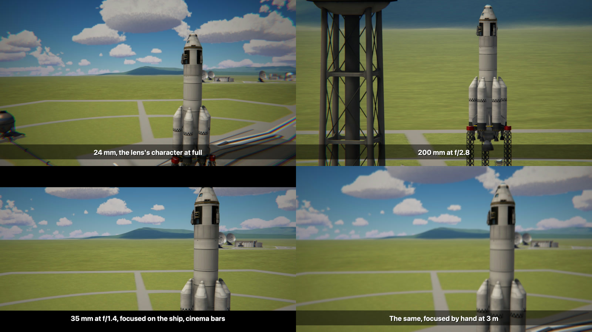
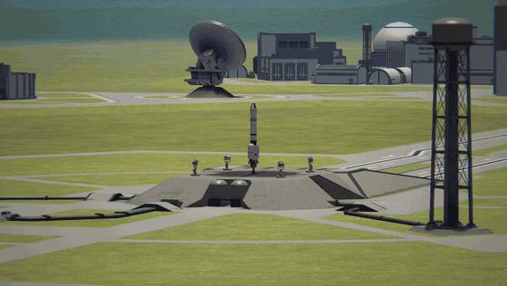

# Cinema Camera

The flight camera worked like a real one: a lens, an aperture, a focus, a shutter and a film speed, each doing to
the picture what it does on a camera. With camera moves, and a viewfinder to look through.

For Kerbal Space Program 1.12.x. **Needs [Keystone](https://github.com/IshiakiZ/ksp-keystone) 0.9 or later**, a separate download
([on SpaceDock](https://spacedock.info/mod/4665/Keystone)): this mod does not load without it.

## Install

Copy the `CineCamera` folder from the download into your KSP's `GameData`, beside `Keystone`.

## Use

Open the Keystone window (the keystone button on the game's toolbar, or Alt-K; Option-K on a Mac), turn to
**Cinema Camera** and switch it on.

* **Focal length, aperture, focus, shutter and film speed:** what the camera sees, what is sharp, motion blur and
  grain. **Exposure** `by the camera` makes them set how bright the picture is, as on a real camera. Lamps shining into
  the lens flare as they do in a real one: a glare, rays from the aperture, faint ghosts (0.7.0).
* **Camera moves:** stay and follow a launch from beside the pad, track it from kilometres off through a long lens as
  launches are filmed, chase it as a chase plane does, drift beside a ship in orbit, circle the ship, or fly a path of up
  to twelve points; from one move to the next a dissolve, a way through black, or a cut. Held by hand if you like, and
  shaken by a launch's roar once its sound gets to the camera. A change of focus is pulled, as a focus puller does.
* **Viewfinder:** a camera's instruments in place of the game's (a focus bracket, a light meter, timecode), and
  **bars** for a 1.85:1 or 2.39:1 picture.
* **Real cameras and LUTs:** 39 real cameras (ARRI, RED, Sony, Canon, Blackmagic and more), each with its own screen,
  recording in its maker's log; a LUT laid on live, Cinema Camera's own or any `.cube` in
  `CineCamera/PluginData/LUTs` (0.7.0).
* **Keys,** with Alt held (Option on a Mac): `C` the camera on and off, `V` the viewfinder, `F` what the focus is on,
  `T` leaves the camera where it is, `Y` flies the path, `Page Up` and `Page Down` pull the focus.

[What each setting does](https://github.com/IshiakiZ/ksp-cinema-camera/wiki/Settings); [the cameras and LUTs](https://github.com/IshiakiZ/ksp-cinema-camera/wiki/Real-cameras-and-LUTs).

## Works on

Windows 11 (Direct3D 11 and OpenGL) and Mac: tried, with TUFX and without it. On Windows on 2026-10-20 a camera with its LUT,
false colour and focus peaking, on both (Direct3D's picture came out upside down with the look on until it was mended that
day). Linux: never run.

**More:** [the long description](https://github.com/IshiakiZ/ksp-cinema-camera/wiki/The-long-description) (everything in full, and what
was tried on each system) and the rest of the [wiki](https://github.com/IshiakiZ/ksp-cinema-camera/wiki).

## Licence

[CC BY 4.0](LICENSE): use it, change it and pass it on as you like, as long as you credit Ishiaki and link back here.
