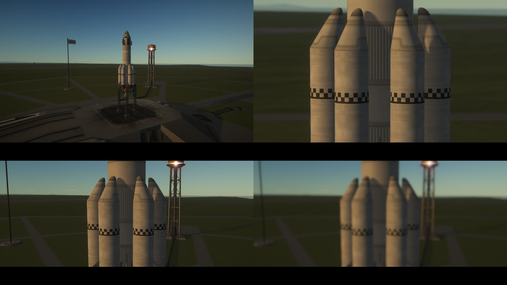
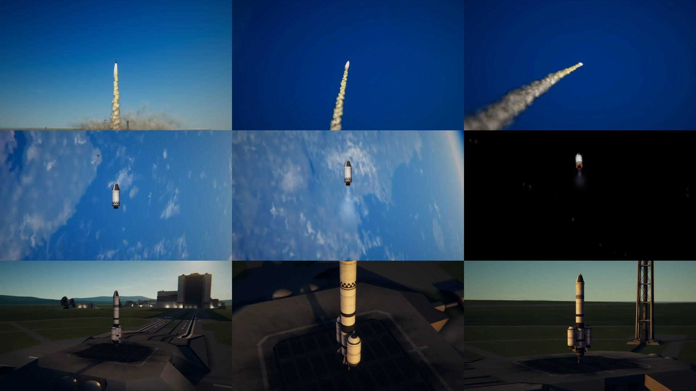

# Cinema Camera

The flight camera worked like a real one: a lens, a sensor, an aperture, a focus, a shutter and a film
speed, each doing to the picture what it does on a camera. And a viewfinder to look through.

For Kerbal Space Program 1.12.x. Needs [Keystone](https://github.com/IshiakiZ/ksp-keystone), a separate download ([its page on SpaceDock](https://spacedock.info/mod/4665/Keystone)) without which this mod does not load, and
nothing else: the blur, the smear and the grain are done by a lens of Keystone's own.

## Install and use

Install [Keystone](https://github.com/IshiakiZ/ksp-keystone) first: it is a download of its own, and its `Keystone` folder goes into your KSP
`GameData`. Then copy the `CineCamera` folder from this mod's download into `GameData` beside it.
Open the Keystone window (the keystone button on the game's toolbar, or Option-K on a Mac, Alt-K
elsewhere), turn to **Cinema Camera** and switch it on.

* **Focal length** and **Sensor** set how much the camera sees (the game's zoom keys turn the lens too).
* **Aperture** and **Focus on** set what is sharp: the ship, the middle of the picture, or a distance.
* **Shutter** is motion blur, **Film speed** is grain, **Lens character** the lens's own marks.
* **Exposure** `by the camera` makes aperture, shutter and film speed set how bright the picture is, as on
  a real camera (full sun wants f/16 at 1/100 s on ISO 100); a **grey filter** holds the light back.
* **Bars** gives a 1.85:1 or 2.39:1 picture.
* **Camera move**: `stay here and follow` leaves the camera where it is, fixed to the ground, and turns
  it after the ship as it flies off, drawing the lens out to keep it in the picture: the shot of a launch
  from beside the pad. `drift and follow` is the same in space: the camera goes on at the speed the ship
  had, as a camera on a second spacecraft would, and a burn takes the ship away from it. `circle the
  ship` takes it slowly round. `fly the path` flies a path of up to twelve points (place, aim, lens) put
  on the camera's page, kept for each craft.
* **Keys**, with Option (Alt) held: `C` the camera on and off, `V` the viewfinder, `F` what the focus is
  on, `T` leaves the camera where it is and takes it back, `Y` flies the path, `Page Up` and `Page Down`
  pull the focus by hand.

*`stay here and follow` (a launch, from 500 m off the pad); `drift and follow` (a burn away from the
camera, in orbit); `fly the path` (four points round a rocket on the pad).*

In the cockpit, the lens is put in front of the cockpit's own camera: the inside and the view through the
windows go through it together, its zoom is the focal length, and the focus finds the instrument looked at.

[What each setting does](docs/Settings.md).

## The viewfinder

**Viewfinder** takes the game's own instruments away and shows a camera's instead: corner marks, a focus
bracket that turns green when the focus has settled, a recording light with the mission's timecode, the
picture's size and frame rate, the ship's battery, a light meter (how many stops over or under a middle
grey the picture comes out, centre-weighted or spot), and along the bottom the lens, f-number, shutter,
film speed and focus. `with thirds` adds the lines a picture is composed on. F2 puts everything back.

## Where it works

| System | |
| --- | --- |
| Mac | Made and tried here (KSP 1.12.5, OpenGL), with TUFX and without it. |
| Windows | Tried on Windows 11 (KSP 1.12.5, Direct3D 11), without TUFX: Keystone's own lens, by its shader built for Direct3D (the narrower view of a 50 mm lens, focus on the ship), the viewfinder and its light meter, the bars, and the camera taken round the ship. Then with TUFX: its lens in place of Keystone's (at 135 mm, f/2, focused at 300 m, the ship 21 m off went soft through each, more through TUFX's), and on the release build with Keystone's Direct3D lens taken out, TUFX's chosen by itself ("The blur, the smear and the grain are being done by TUFX"); a path of four points round the ship, flown; the cockpit, through both lenses. |
| Linux | **Never run.** The lens there is the OpenGL shader the Mac runs. |

[More](docs/Which-systems-it-works-on.md).

More: [moves and paths](docs/Moves-and-paths.md),
[how it works](docs/How-it-works.md),
[limits](docs/Limits.md),
[building it yourself](docs/Building.md).

## Licence

[CC BY 4.0](LICENSE): use it, change it and pass it on as you like, as long as you credit Ishiaki and link back here.
