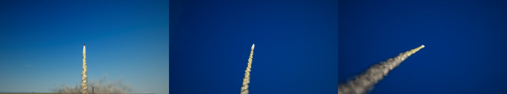
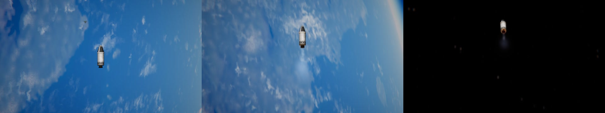
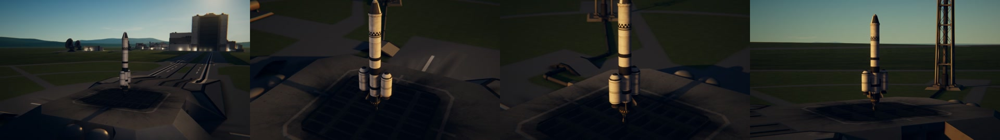
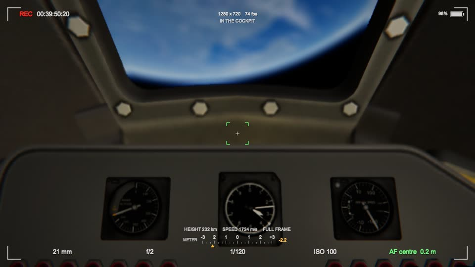

# Moves and paths

The camera can be moved as a camera crew moves one. Each move is chosen under **Camera move** on the
camera's page, and none is kept from one flight to the next.

| Move | What the camera does |
| --- | --- |
| `stay here and follow` | It is left where it is, fixed to the ground (or to the spot over the ground that it is at), and turns after the ship as it flies off, a moment behind, as a hand on a tripod turns a camera. The shot of a launch from beside the pad |
| `circle the ship` | It goes slowly round the ship (**Circling** sets how fast, and which way) |
| `drift and follow` | For space. It is left where it is, going on at the speed the ship had, as a camera on a second spacecraft would: it drifts along its own orbit, a burn takes the ship away from it, and it turns to follow |
| `fly the path` | It flies through the points of the path set for the craft (below), in the time **Path takes** gives it |

With **Zoom to keep the ship's size** on, a camera that stays or drifts draws its lens out as the ship
gets further off, so that the ship stays the size it was in the picture (as far as a 2400 mm lens, which
is what the cameras that follow real launches have). Set the focal length first: that is the size kept.

The modifier key (Option on a Mac, Alt elsewhere) and `T` leave the camera where it is and take it back:
near the ground it stays fixed to the ground, in space it drifts (in orbit, or above the air going fast or
high). The modifier and `Y` fly the path, and stop it.

*`stay here and follow`: the camera was left 500 m from the pad with a 35 mm lens, and followed the launch
from there.*

## Drift and follow

*`drift and follow`, recorded frame by frame in orbit 240 km up: the camera was left 120 m from the capsule
with a 135 mm lens; one second in, the capsule coasting beside it; five seconds in, burning away; eight
seconds in, gone up into space with the lens drawn out to follow (it reached about 2200 mm).*

When the move begins, the camera is given an orbit of its own: the one a thing let go of where the camera
is, moving exactly as the ship was moving, would have. It is made the way the game makes the ship's own
orbit from where the ship is and how fast it goes, and every frame the camera is put where that orbit has
it, as the game does for anything on rails. So it does not wander however long it is left, and nothing but
the ship's own engines (or the small difference between two orbits side by side) moves the ship in the
picture. Left beside a rocket that has not yet reached orbit, it drifts on the path the rocket was on,
and is taken back to the ship before it would reach the ground.

It keeps the roll it had when it was left (in space there is no level to come back to), and it turns after
the ship a moment behind, the more closely the narrower its lens sees, so that a ship burning away stays
in a long lens's picture.

A ship that has gone far, compared with how far off the camera was left, is seen from behind: one that
burns away from a camera 30 m off is end-on within seconds. For a ship seen side-on as it goes, leave the
camera a few hundred metres to one side of the way it will burn.

The move ends by itself when the ship is 250 km off or goes into the sphere of another world. Time warp
leaves it as it is: a camera left drifting 25 m from a capsule in orbit was 28 m from it after five minutes
of warp, which is what two orbits that close come apart by.

## Paths

*`fly the path`: four points round a rocket on the pad (35 mm, 35 mm, 50 mm, 85 mm), flown in 8 seconds.*

A path is a few points, each a place, a way of looking and a lens. They are set on the camera's page,
under **Path**, with the camera put where each should be:

1. Put the camera where the shot is to begin (with the mouse, the game's keys and the zoom, as ever) and
   press **Put a point here**.
2. Move the camera to where it is to go next, and put another point. Up to twelve.
3. Press **Fly it** (or choose `fly the path` as the camera move, or press the modifier and `Y`).

The camera goes through the points in order, the same time from each to the next, gathering speed over
the first fifth of the path's time and slowing to a stop over the last fifth, as a camera on a crane or a
dolly is moved. The line it takes is a smooth curve through the points (a centripetal Catmull-Rom curve,
which neither overshoots a point nor loops between two close ones). The way it looks is kept against
looking at the ship: points put with the game's own camera all look at the ship, and the camera then looks
at it all the way along; a point that looks beside the ship keeps it as far to one side there. The lens is
drawn in or out evenly in stops. When the path has been
flown, the camera stays at its last point until the move is changed, and then goes back to the ship.

**Take the last away** and **Clear** change the path. A path is kept for the craft being flown, under its
name, in the camera's settings file: the next time a craft of that name is flown, its path is there.

**The points go along with the ship.** They are kept relative to the ship's middle, turned the way the
game's own camera was turning with the ship when the first point was put:

* in the game's free camera (the usual one near the ground), north stays north and up stays up;
* in its orbital camera, the stars stay where they are;
* in its locked camera, the points turn with the ship;
* in its chase camera, they turn with the way the ship is heading.

So a path set round a rocket on the pad rises with the rocket if it is flown during the launch (for the
rocket leaving the camera behind, use `stay here and follow`), and a path set round a plane in the chase
camera stays beside it whichever way it turns.

The path's clock is the player's, not the game's: a path is flown in the time it is given whether the
game runs slow or fast (in time warp too). It stops while the game is paused.

## In the cockpit

In the cockpit the game holds the flight camera to the kerbal's eye itself. A move ends when the cockpit is
entered, and the game's own hold is left alone; outside again, the camera is back with the ship. A path
cannot be set or flown from inside.

The lens itself does work there: it is put in front of the cockpit's own camera, so that the inside and
the view through the windows go through it together. The cockpit's zoom is the focal length (a Mk1 pod's
view is 60 degrees high, a 21 mm lens on full frame), and the focus finds the piece of the cockpit in the
middle of the picture: the instrument panel 20 to 33 cm from the kerbal's eye, the window's frame at 16 cm.
With nothing of the cockpit in the middle it focuses on what is seen outside (not tried: the game does not
let the Mk1 pod's view turn far enough up to put the middle of the picture on its window).

