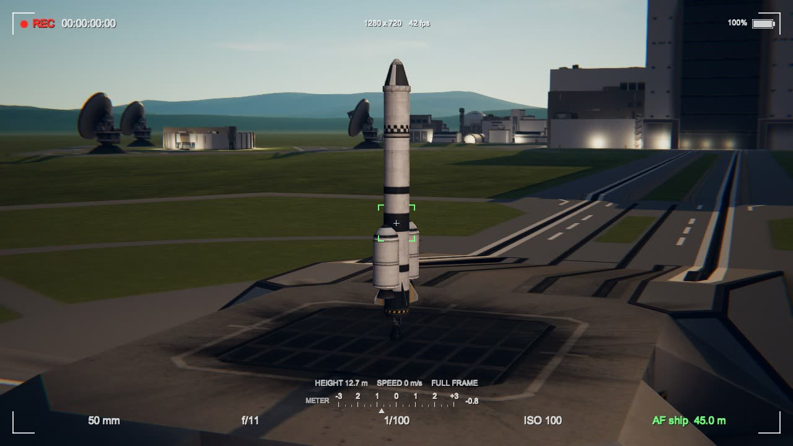

# The viewfinder

Set **Viewfinder** to `on` and the game's own instruments are put away (as F2 does) and a camera's are
drawn in their place, so that the screen looks like the view through a camera:

* **Corner marks** round the picture, inside the cinema bars when those are on.
* **The focus bracket** in the middle: white while the focus is still moving, green when it has settled.
* **Top left:** a recording light and the mission's time as a timecode (hours, minutes, seconds, frames).
* **Top middle:** the picture's size in pixels, and how many frames a second the game is drawing. Under
  it, what the camera is doing when it is doing more than looking: `STAYING` or `DRIFTING` and how far
  off the ship is, `CIRCLING`, the path's time as it is flown, `IN THE COCKPIT`; and for a moment, in
  green, a point of the path put or taken away.
* **Top right:** the electric charge left in the ship being flown, as a camera shows its battery.
* **Along the bottom:** the focal length (the lens in use: drawn out by a move, flown by a path, or the
  cockpit's own), the f-number, the shutter, the film speed, and what the focus is on and how far off that
  is. Above them the light meter (below), and above that the ship's height, its speed, and the sensor.
* **NO BLUR**, in amber near the top, where the lens cannot blur on this computer (see
  [Which systems it works on](Which-systems-it-works-on.md)).

`with thirds` adds two lines each way, a third of the picture apart: what a picture is composed on.

To leave it: set **Viewfinder** to `off`, or press F2, which takes the viewfinder down and brings the
game's instruments back.

It is drawn after the lens has done its work, so it is always sharp. It has been looked at on the launch
pad, in orbit and in the cockpit, in pictures taken by the mod's author; nobody has yet flown with it.

## The light meter

Over the row of settings is a light meter, drawn as a camera's viewfinder draws its own: a scale of stops
from three under (`-3`) to three over (`+3`), a tick at every third of a stop, and a mark under the scale
at what the picture comes to, with the figure beside it. Nought is a picture as bright as a middle grey
(18% of white, as light), which is what every camera's meter aims at, because any ordinary scene averages
out near it. The mark turns amber more than two stops off; beyond three, an arrow blinks at that end.

It reads the finished picture, after the film and the lens: whatever set the exposure (the camera's own
aperture, shutter, film and filter, when **Exposure** is `by the camera`; or the game, or another mod's
eye, when it is `left alone`), the meter says how the picture comes out. When the camera sets the
exposure, the mark moves with the aperture ring and the shutter at once, as on a camera.

* `centre-weighted`: the whole picture counts, its middle most.
* `spot`: only what is inside the focus bracket. For a ship against black space or a bright sky, which
  fool a meter that takes in the whole picture as they fool a real one.

It is worked out a few times a second from the picture shrunk to a few thousand dots on the graphics card,
and only while the viewfinder is up. Where the picture is brighter than white it is taken as white, as
it is shown.
